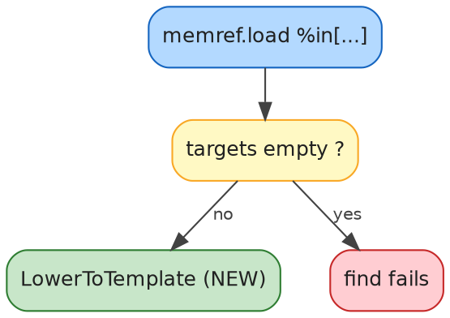

# Markdown Diagrams

Every diagram in the user's Markdown files uses the same formats and the same
colors, so a color means the same thing in every document. The user previews
the files with Markdown Preview Enhanced on a light background.

A chat reply has no diagram block: the chat does not render it. Use a table or
arrow text such as `A → B → C` there.

## Choose the Format

| Content | Format |
| ------- | ------ |
| Structure, flow, dependency, ordering in time | Graphviz, in a ` ```dot ` block |
| Grid, layout, range, precise position, index expression over a grid | Inline HTML: `<table>`, or `<svg>` for geometry |
| Comparison, responsibility | Markdown table |
| "Change a choice, watch the outcome" | Interactive explorer: read `references/interactive-explorer.md` |

Do not use Mermaid or ASCII art. IR and code blocks are not diagrams.

## Rules for Every Diagram

- **One diagram, one axis.** Show structure, time, or space, not two of them.
  Split a diagram that needs edges unrelated to its point.
- **Title by content.** The heading or line above a diagram says what it
  shows, such as "Writes To One Element: Same Order Before And After", never
  "Fig N". Cross-references use that title.
- **Explain below.** Directly below a diagram, say in one or two sentences
  what to look at. Name the colored nodes or cells the reader should compare.
- **ASCII English labels.** Write diagram text in English, even in a Chinese
  document.
- **Agree with the text.** A diagram and its text name the same things with
  the same words.
- **Index expressions.** For an access or layout, give a table of
  result dim → expression → which loop it pins, then draw the iteration grid
  with the element each cell touches, cells colored by dim.

## Role Colors

A node or cell gets a color only for one of these meanings. Leave everything
else white.

| Role | Fill | Border | Use for |
| ---- | ---- | ------ | ------- |
| Data | `#b3d9ff` | `#1565c0` | IR values, buffers, tables, analysis results |
| Decision | `#fff9c4` | `#f9a825` | A check, a question, an analysis step |
| New | `#c8e6c9` | `#2e7d32` | What the change adds or changes; an accepted path |
| Error | `#ffcdd2` | `#c62828` | A failure, a rejected input, a wrong result |
| Context | `#eeeeee` | `#757575` | Unchanged parts, skipped paths, background |

Text is `#212121` and edges are `#424242` everywhere.

## Dim Colors

In a grid or an index-expression table, a color names a dim or a loop IV. A
dim keeps its color in every diagram of the same document.

| Order of first use | Fill |
| ------------------ | ---- |
| 1 | `#bbdefb` |
| 2 | `#ffe0b2` |
| 3 | `#e1bee7` |
| 4 | `#b2dfdb` |
| 5 | `#f8bbd0` |
| 6 | `#d7ccc8` |

A diagram that needs more than six dim colors shows too much: split it, or
group the dims by machine level. Do not mix role colors and dim colors in one
diagram.

## DOT Template

Start every DOT diagram from these defaults, and set only `fillcolor` and
`color` per node from the role table:



Use `rankdir=TB` for a process and `rankdir=LR` for an interface.

## HTML Grid Template

Write every style inline, so the diagram renders the same wherever the file
goes. Leave a blank line before and after the HTML block.

```html
<table style="border-collapse:collapse;font-family:Helvetica,Arial,sans-serif;font-size:12px;color:#212121;text-align:center">
  <tr>
    <th style="padding:4px 8px"></th>
    <th style="padding:4px 8px;background:#ffe0b2">t = 0</th>
    <th style="padding:4px 8px;background:#ffe0b2">t = 1</th>
  </tr>
  <tr>
    <th style="padding:4px 8px;background:#bbdefb">c = 0</th>
    <td style="border:1px solid #757575;padding:4px 8px">PE(0, 0)</td>
    <td style="border:1px solid #757575;padding:4px 8px">PE(0, 1)</td>
  </tr>
</table>
```

Color the header that names a dim with that dim's color. Color a cell with a
role color only when the cell itself is the point, such as the one element a
wrong index reaches.

## Check Before Handing Over

Run the DOT check on every file you drew in:

```bash
python3 <skill-dir>/scripts/check_dot.py <file.md> [<file.md> ...]
```

It renders each ` ```dot ` block with Graphviz and names the heading of each
block that fails. Fix every failure before you give the file to the user. For
an interactive explorer, run the checks in `references/interactive-explorer.md`.
